<p align="center"></p>

# Glasshouse — Hearth themes & weather edition

An **unofficial fork** of [Glasshouse](https://github.com/rorygallagher2024/glasshouse) by Rory Gallagher that adds three things to **Glasshouse Home**, the home screen Glasshouse puts in place of LG's on a rooted webOS TV:

1. **Hearth themes** — load any theme made for [Hearth](https://github.com/rudra-avatar/Hearth) (one `.zip`): colours, fonts, wallpaper or slideshow, icon style, and the apps' order, names and icons. Switch them from the web dashboard or with the remote.
2. **Weather** — a panel right of the clock: conditions and temperature now, feels-like, wind and humidity, and a five-day forecast, from [Open-Meteo](https://open-meteo.com) (free, no account, no API key).
3. **Live preview fix for webOS 5** — the live HDMI preview *in the tile* stayed blank on webOS 5 (e.g. LG CX). It now plays.

Everything else is upstream Glasshouse, unchanged. This fork updates itself from **this** repository's releases.

<p align="center">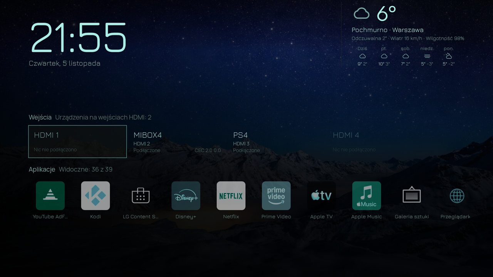</p>

## Contents

- [Install](#install)
- [Hearth themes](#hearth-themes)
- [Weather](#weather)
- [Live preview on webOS 5](#live-preview-on-webos-5)
- [Screenshots](#screenshots)
- [Updating, building and releasing](#updating-building-and-releasing)
- [Credits and licences](#credits-and-licences)
- [Upstream README](#upstream-readme)

## Install

You need a **rooted** LG webOS TV with the [Homebrew Channel](https://github.com/webosbrew/webos-homebrew-channel) (root shown as *ok* in its settings). Glasshouse needs root; its catalog entry is marked `rootRequired`, so the Homebrew Channel gives it root on install by itself — nothing to do by hand. It does not work on a TV without root. See upstream's [Homebrew Channel guide](docs/install-homebrew-channel.md) if you don't have it yet.

### Which root methods work

Glasshouse needs two things from the root, and this fork changes neither:

- **The Homebrew Channel has root** (*Root status: ok* in its settings). On first launch the Glasshouse app runs its installer as root through the Homebrew Channel's `exec` service, and the Homebrew Channel elevates the app because its catalog entry says `rootRequired`.
- **The Homebrew Channel's start-up hook runs at boot**, which runs `/var/lib/webosbrew/init.d/*`; Glasshouse's hook there starts the server after each cold boot.

The usual webosbrew roots give both: [dejavuln-autoroot](https://github.com/throwaway96/dejavuln-autoroot), [faultmanager-autoroot](https://github.com/throwaway96/faultmanager-autoroot), [RootMyTV](https://rootmytv.github.io/) and crashd. Upstream lists TVs tested with them in [docs/tested-tvs.md](docs/tested-tvs.md).

**NZ Store (natxo) root** is different: it roots the system but leaves the Homebrew Channel unelevated and does not run `/var/lib/webosbrew/init.d` at boot. On such a TV (this fork was tested on one), over SSH as root:

```sh
# give the Homebrew Channel root, then let the TV's service hub read it again
/media/developer/apps/usr/palm/services/org.webosbrew.hbchannel.service/elevate-service
ls-control scan-services
# after installing Glasshouse and opening it once: start it at boot from natxo's own hook folder
cp /var/lib/webosbrew/init.d/50-tvweb /media/developer/natxo/init.d/50-tvweb
chmod 755 /media/developer/natxo/init.d/50-tvweb
```

The elevation is lost when the TV restarts, so put the first two lines in a script in `/media/developer/natxo/init.d/` too (run after a delay of ~20 s, in the background).

### A. From the Homebrew Channel (recommended)

1. Open the **Homebrew Channel** → **Settings** → **Add repository**.
2. Enter this address and confirm:

   ```
   https://raw.githubusercontent.com/quzopl/glasshouse/main/repo.json
   ```

3. Go back to the app list, open **Glasshouse** and press **Install** (it needs root, which the Homebrew Channel gives it).
4. Open **Glasshouse** from the TV's home screen. The first launch puts the server in place, which takes a few seconds; setup then asks whether phones and computers on the network may use the dashboard. After that the dashboard is at `http://<tv-ip>:8080/` (the port can be changed).

Installed this way, updates come through the Homebrew Channel: it offers new releases of this fork as updates.

> If you also have the official Glasshouse catalog (or the default webosbrew repository lists Glasshouse), keep only one of them enabled: both offer the same app id, and the Homebrew Channel would install whichever has the higher version.

### B. From Glasshouse's own app catalog

Already running Glasshouse? In the web dashboard open **Apps** → **Install homebrew apps** → **Other app catalogs**, paste `https://github.com/quzopl/glasshouse` and choose **Add catalog** (Glasshouse reads the repository's `repo.json` by itself; adding a catalog needs **Install app from a URL or file** on, or a token). Then update **Glasshouse** from that catalog's list.

### C. Manually

Download `io.github.rorygallagher2024.lg-webos-dashboard_<version>_all.ipk` from the [latest release](https://github.com/quzopl/glasshouse/releases/latest) and install it with the Homebrew Channel's file option, webOS Dev Manager, or over SSH:

```sh
scp io.github.rorygallagher2024.lg-webos-dashboard_*_all.ipk root@<tv-ip>:/media/developer/temp/gh.ipk
ssh root@<tv-ip> 'luna-send -n 1 luna://com.webos.appInstallService/dev/install \
  "{\"id\":\"testing\",\"ipkUrl\":\"/media/developer/temp/gh.ipk\",\"subscribe\":false}"'
```

Or from a checkout, straight onto the TV over SSH (needs key login): `server/deploy.sh <tv-ip>`.

### Switching an existing Glasshouse to this fork

Install this package over it (any of the ways above). The app id is the same, so settings, Home layout and wallpapers stay, and an install made with `deploy.sh` is taken over in place the first time the app is opened. From then on updates come from this repository instead of upstream. To go back, install upstream's package again.

## Hearth themes

[Hearth](https://github.com/rudra-avatar/Hearth) is another home screen for webOS. Its themes are a single zip with a `manifest.json` ([format and rules](https://rudra-avatar.github.io/Hearth/theme/theme-guide/)). This fork reads them as Hearth does — an unknown key, a missing file or anything other than pictures, fonts, the manifest and notes refuses the zip, and the dashboard says why.

**What a theme changes on Glasshouse Home**

| Theme part | On Glasshouse Home |
|---|---|
| `colors.theme` (black, grey, midnight, forest, teal, graphite) | accent colour, background behind the wallpaper, and the text colour if the theme names no widget colour |
| `colors.widget` / `colors.widgetInk` | text colour (clock, date, weather) |
| `fonts` (`widget`, `names`) | font of the clock, date and weather; font of the tiles' names |
| `wallpaper` (`file` or `folder`, `intervalSec`, `shuffle`) | one picture, or a slideshow, in place of the chosen wallpaper |
| `apps` | the Apps row's order, and new names |
| `icons` | the apps' icons |
| `cities` | offered as places for the weather |
| `iconStyle.style` (mono, soft, gradient, accent, tinted) | the apps' icons drawn grey, dimmed, high-contrast or tinted, with CSS filters on their own pictures |
| `colors.icon` | the colour of accent and tinted icons (else the theme's text colour) |
| `iconStyle.tile` | nothing on Glasshouse Home: listed as *not used* |

Colours and app order go into the normal Home settings, so you can still change them while the theme is on. **Remove the theme** puts back the colours and order it replaced.

**Using themes**

- Put theme zips in **`/media/developer/themes`** on the TV (the folder Hearth uses), e.g. `scp mytheme.zip root@<tv-ip>:/media/developer/themes/`.
- **Web dashboard** → **Home** → **Hearth theme**: every zip in that folder is a button; **Load a theme zip…** uploads one from your computer; **Remove the theme** takes it off.
- **With the remote**: open the **Glasshouse** app → **Home** → **Hearth theme**. Each **OK** loads the next zip, and after the last one goes back to none.

**Ten ready-made themes** are attached to every [release](https://github.com/quzopl/glasshouse/releases/latest), one zip each. They use Hearth's public-domain photos and SIL OFL fonts that include Polish and other Central European letters, and list ten Polish cities for the weather (any place can be found by name):

| Zip | Name | Look |
|---|---|---|
| `polar-night.zip` | Polar Night | teal palette, aurora and starry skies, Jura, teal-tinted icons |
| `forest.zip` | Forest | forest green, ferns and an autumn river, Work Sans, tinted icons |
| `ocean.zip` | Ocean | teal, waves and a reef, Outfit, original icons |
| `mountains.zip` | Mountains | blue-grey, misty peaks, Lora, soft icons |
| `campfire.zip` | Campfire | graphite and amber, lava and sunsets, Bricolage Grotesque, amber icons |
| `midnight.zip` | Midnight | midnight blue, night landscapes, Poiret One, blue icons |
| `zen.zip` | Zen | light grey, a pier in the fog and Mount Fuji, Poppins, soft icons |
| `retro.zip` | Retro | OLED black, green pixel font (Pixelify Sans), green icons |
| `terminal.zip` | Terminal | OLED black, console green, JetBrains Mono, green icons |
| `oled-black.zip` | OLED Black | OLED black, white, Big Shoulders, grey icons |

The three black themes have no wallpaper of their own, so your normal Glasshouse wallpaper stays behind them; choose *None* under **Wallpaper** for pure black.

**Making your own**: start from Hearth's [example zip](https://github.com/rudra-avatar/Hearth/blob/main/docs/theme/theme_name.zip) or one of the ten above, edit `manifest.json`, zip it again with `manifest.json` at the top of the zip. Use fonts that cover the letters of your language — many web font files are Latin-only subsets.

Limits: the zip at most 40 MB, at most 60 MB unpacked; an entry that unpacks to more than it declares refuses the zip (zip-bomb protection).

## Weather

**Web dashboard** → **Home** → **Weather**:

- **On / Off**, and **°C / °F** (with °F, wind is in mph).
- Type a place and press **Find** (Open-Meteo's geocoding, in the dashboard's language), then pick the right result. The cities of the theme that is on are offered too.

**With the remote**: Glasshouse app → **Home** → **Weather** switches it on and off; **Weather place** steps through the theme's cities.

The panel sits right of the clock: the conditions' icon and the temperature, the conditions and the place, feels-like temperature, wind and humidity, and five days with their icons, highs and lows. It follows the theme's text colour and font. It is hidden while a live preview is shown *beside the clock* (with **Preview in the tile** it stays).

The TV asks `api.open-meteo.com` at most every 20 minutes while the weather is on, and `geocoding-api.open-meteo.com` only when you search for a place. Nothing is sent except the place's coordinates. The setting is kept in `/var/lib/tvweb/home-weather.json`.

## Live preview on webOS 5

With **Live preview** and **Preview in the tile** on, the input's picture stayed blank on webOS 5: the page moved the video into the tile after starting it, and webOS 5's browser stops a media element that is moved. The preview is now placed first and started after. Tested on an LG OLED55CX (webOS 5, firmware 04.64.00).

## Screenshots

All taken on an LG OLED55CX. The HDMI preview does not show in screenshots: the TV captures only the page, not the video plane. The Terminal and OLED Black shots were taken before icon styles came, so their icons show in colour.

<p align="center">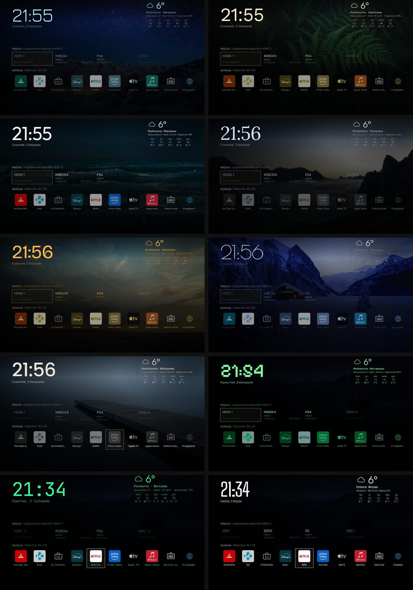</p>

| | |
|---|---|
|  Polar Night | 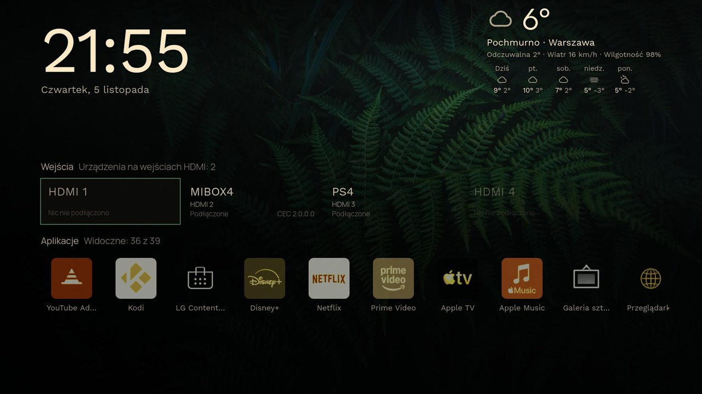 Forest |
| 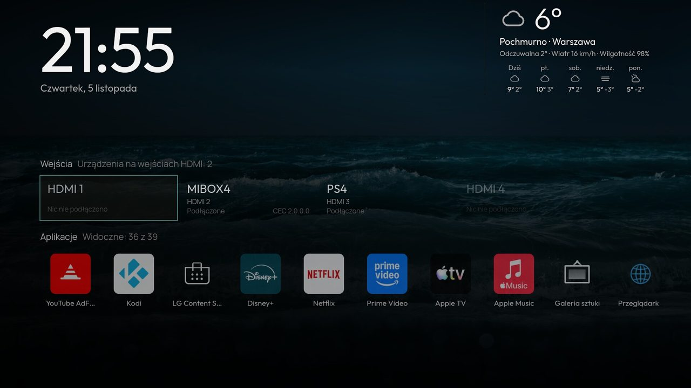 Ocean | 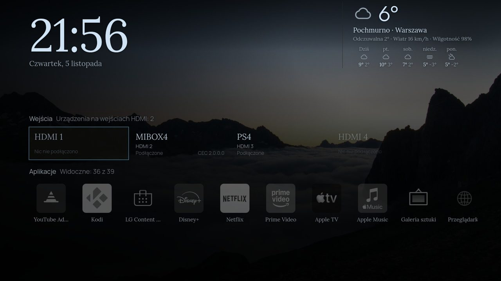 Mountains |
| 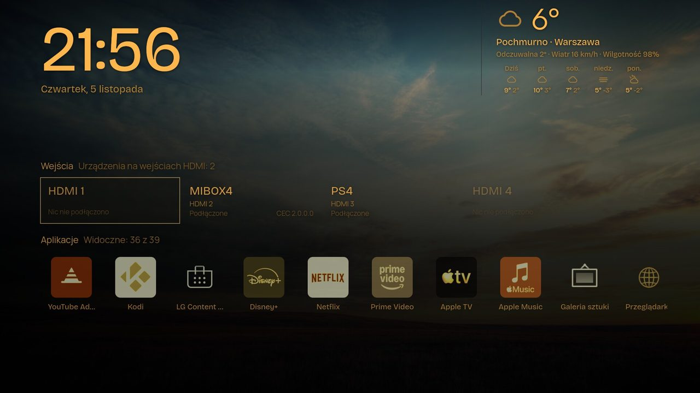 Campfire | 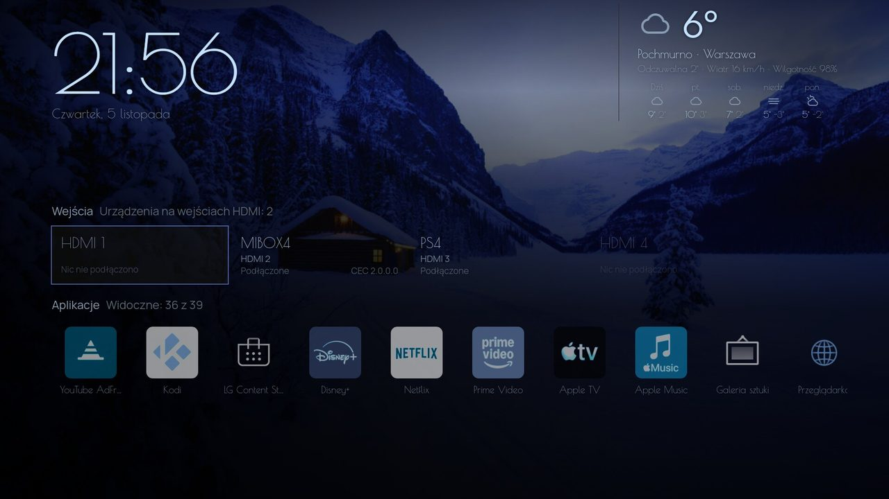 Midnight |
| 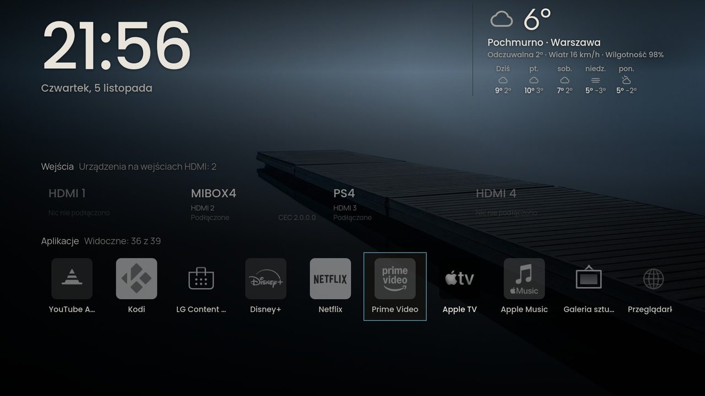 Zen | 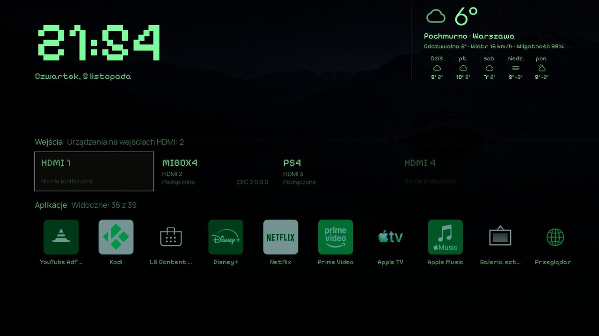 Retro |
| 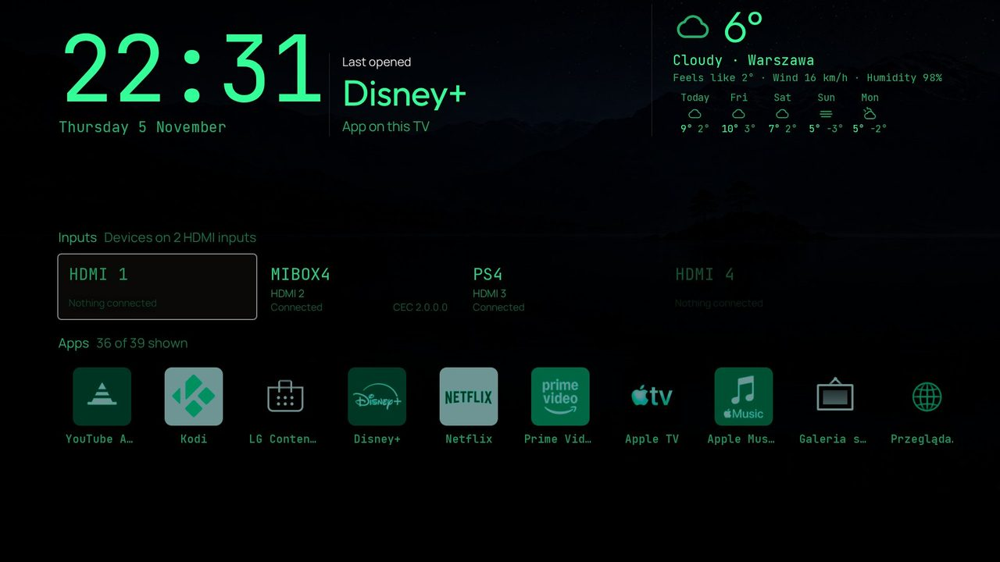 Terminal | 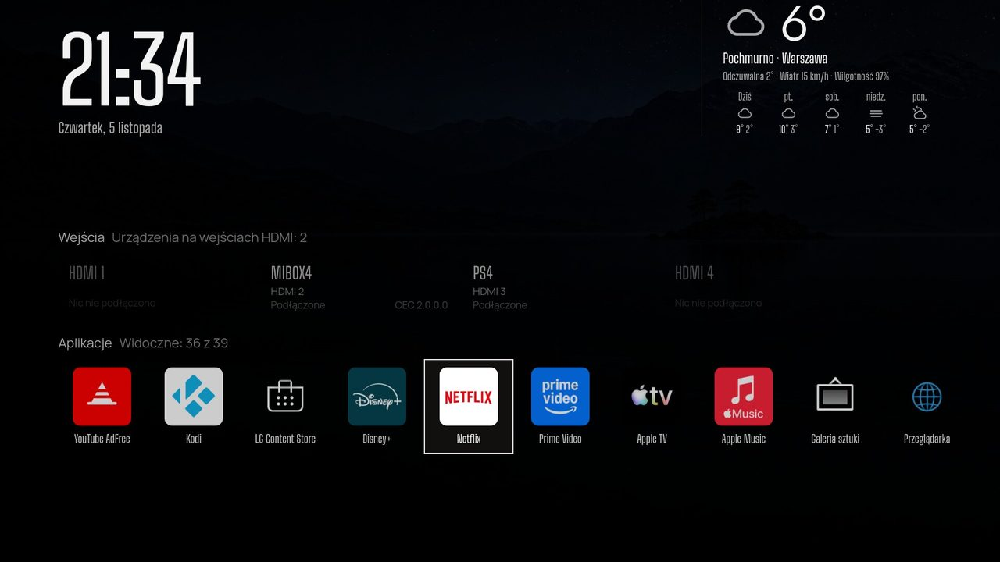 OLED Black |

**The weather panel**

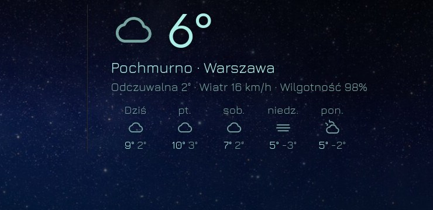

**Web dashboard → Home → Hearth theme**

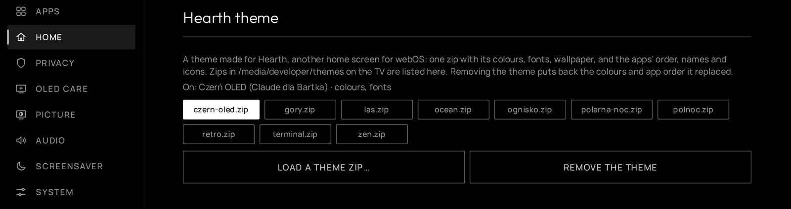

**Web dashboard → Home → Weather**

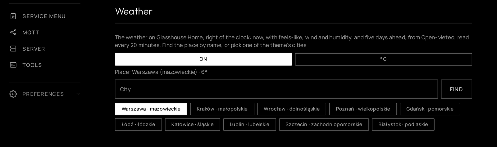

**Glasshouse app on the TV → Home** (theme and weather with the remote)

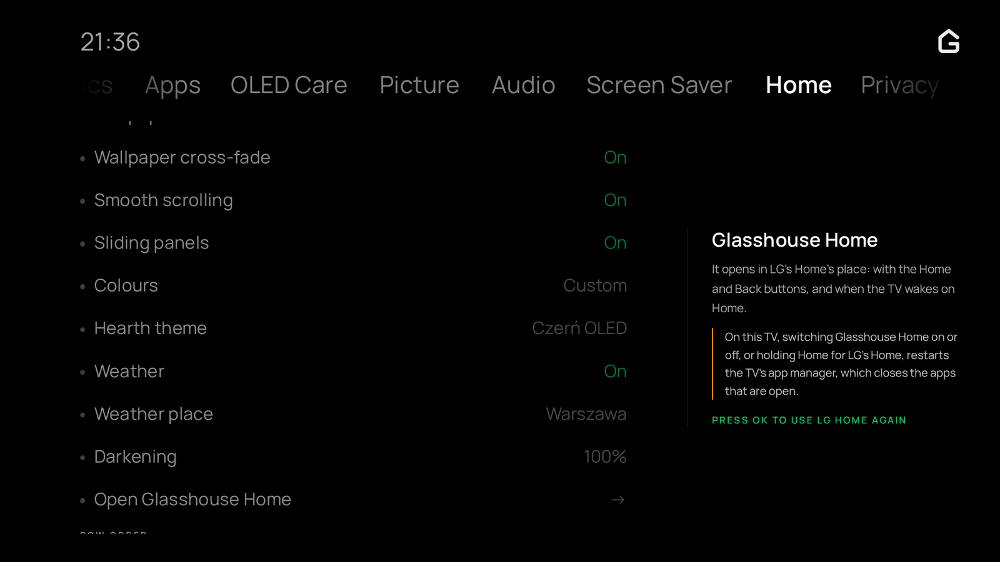

## Updating, building and releasing

**Updating on the TV**: installed from the Homebrew Channel, updates come through it; installed with `deploy.sh`, the web dashboard's **Server** tab updates from this repository's releases.

**Building** (needs Python 3 and Node.js):

```sh
npm install --prefix /tmp/ares @webos-tools/cli@3.2.6
ARES_PACKAGE=/tmp/ares/node_modules/.bin/ares-package python3 scripts/build-ipk.py   # -> dist/*.ipk, dist/*.manifest.json
python3 scripts/fork-repo-json.py                                                    # -> repo.json, absolute ipkUrl in the manifest
```

**Releasing**: set `TVWEB_VERSION` in `server/tvweb.js` (and `package.json`), build as above, commit `repo.json`, tag `v<version>`, and attach the `.ipk`, the `.manifest.json` and the theme zips to a GitHub release with the same tag. `repo.json` on `main` points at that release.

**Checks**: `scripts/check-all.sh` (as upstream), including the new suites `test/test-home-theme.js` and `test/test-home-weather.js`.

**What changed against upstream** (code):

- `server/lib/home-theme.js` — Hearth zips: streaming unzip with size limits, manifest checks as Hearth's, storage in `/var/lib/tvweb/home-theme`, names/icons on the apps, fonts/background/wallpaper for the view.
- `server/lib/home-weather.js` — Open-Meteo forecast and geocoding through the TV's curl/wget.
- `server/lib/home.js`, `server/lib/routes.js` — wiring and `/api/home/theme*`, `/api/home/weather*`.
- `server/assets/home.html` — theme fonts, background and slideshow; the weather panel; the webOS 5 preview fix.
- `server/assets/ui.html`, `ui/home.js`, `ui/ui.css`, `dashboard.html` — dashboard sections and TV app rows.
- `server/lib/updater.js`, `scripts/build-ipk.py`, `scripts/fork-repo-json.py`, `repo.json` — releases from this repository.

## Credits and licences

- **Glasshouse** © Rory Gallagher, [MIT](LICENSE) — all of the base project. Please report problems with the additions above here, not upstream.
- **Hearth** © its authors, MIT — theme format, palettes, and the photos and fonts used in the ten themes.
- Photos in the themes: public domain (as stated by Hearth's `THIRD_PARTY_NOTICES.md`). Fonts: SIL Open Font License 1.1; each theme zip carries its font's licence as `FONT-LICENSE.txt`.
- Weather data: [Open-Meteo](https://open-meteo.com), CC BY 4.0.

This fork is not affiliated with LG, webOS, Hearth or upstream Glasshouse. Rooting and running homebrew on your TV is at your own risk.

---

## Upstream README

# Glasshouse (upstream)

**Own the glass.** A dashboard, privacy controls and Home Assistant bridge for rooted LG webOS TVs.

> [!NOTE]
>
> ## You bought the TV.
>
> **It's your TV and you should control it. You own the glass.**
>
> Designed for those who reject their network-connected home appliances being
> used as a platform for advertising, telemetry and vendor-controlled
> experiences, this project brings control, visibility and automation back to
> the device.
>
> It offers multiple ways to remove ads, withdraw from agreements and services
> designed to monetize your data, and make the TV a simpler, more streamlined
> experience — alongside a wide range of useful features, customisation and
> local smart-home integration.
>
> Glasshouse itself is local, transparent, and requires no cloud service.
> No nonsense, no data collection, no ads, no dark patterns. I don't want your data.

**Glasshouse** is a server that runs directly on a rooted LG webOS TV, providing both a live browser dashboard and a dashboard app.

Use it for remote control, app installation and removal, OLED panel care, privacy controls, service menu access, and hardware telemetry. It also includes an MQTT bridge for integrating the TV with Home Assistant and other smart-home software.

### Compatibility at a glance

* **webOS**: 2.2 through 11 (LG's webOS 26) confirmed; tested across 2015–2026 models. Other versions likely work as well. LG names its versions two ways: [webOS version numbers](https://rorygallagher2024.github.io/glasshouse/tested-tvs/#webos-version-numbers) gives both
* **Panels**: OLED (full panel wear telemetry and burn-in controls) and LCD (core dashboard, controls, and telemetry; OLED Care tab hides automatically)
* **Access**: Rooted via [Homebrew Channel](https://github.com/webosbrew/webos-homebrew-channel). Telnet or SSH. No external dependencies or internet access needed on the TV
* **Tested hardware**: 66 TVs across 43 series verified so far (LF632V, UH600V, UH6030, UH610V, UH635V, B6, B7, SJ80, UJ63, B8, C8, LK61, UK63, LM57, UM71, UM73, C9, CX, GX, UN73, C1, UP80, UP81, QNED82, UQ80, C2, G2, C3, UR80, B4, G3, C4, G4, UT73, UT81, C5, G5, CS, LX3, UA73, C6, NU80, QNED84). Other rooted models should work; [see full table](https://rorygallagher2024.github.io/glasshouse/tested-tvs/)

**[Read the documentation](https://rorygallagher2024.github.io/glasshouse/)** for the features, installation, Home Assistant and security.

---

## Quick start

1. Root the TV and install the [Homebrew Channel](https://github.com/webosbrew/webos-homebrew-channel).
2. Clone this repository on a computer on the same network as the TV.
3. Run `./deploy.sh <tv-ip>` from the `server/` directory.
4. Open `http://<tv-ip>:8080/` in a browser.

That's it. The dashboard is ready to use.

The [installation guide](https://rorygallagher2024.github.io/glasshouse/install/) has the details and troubleshooting.

---

## What it's for

This project is intended to give a rooted webOS TV a useful local control surface instead of requiring the owner to work around the TV's built-in menus, vendor services and cloud dependencies.

1. **[A cleaner Home screen](https://rorygallagher2024.github.io/glasshouse/dashboard/home/).** A replacement Home app with full control over what displays, and no ads, with a row of Internet TV channels from your own IPTV playlist. Available on webOS 4, 5, 6, 7, 9, 10 and 11; webOS 3 and later versions can try it with a setting.

2. **[Controlling the TV without the cloud](https://rorygallagher2024.github.io/glasshouse/dashboard/control/).** Remote's keys, volume, inputs, power, sleep timer, comprehensive picture and sound settings, Game Optimizer, and much more.

3. **[Seeing what the TV is configured to collect, and switching it off](https://rorygallagher2024.github.io/glasshouse/dashboard/privacy/).** One button to turn ads and telemetry off, including LG's content-recognition engine. Every data agreement is recorded in the app, with most of them switchable from the dashboard.

4. **[App management and debloating](https://rorygallagher2024.github.io/glasshouse/dashboard/apps/).** Install apps from the Homebrew Channel catalog, uninstall apps, disable unnecessary background system services to free up RAM and CPU cycles, stop LG keeping apps loaded in the background that are never used, and hide non-removable built-in LG system apps from LG's Home.

5. **[Remapping the remote's buttons](https://rorygallagher2024.github.io/glasshouse/dashboard/apps/#remote-keys).** Point Netflix, Prime Video, Guide, the color keys and the TV's other shortcut buttons at any installed app, an HDMI input or Live TV, or turn them off.

6. **[Replacing the screen saver](https://rorygallagher2024.github.io/glasshouse/dashboard/screen-savers/).** Over a dozen screensavers to choose from, and customisable brightness settings.

7. **[Integrating the TV with a smart home](https://rorygallagher2024.github.io/glasshouse/HOME-ASSISTANT/).** The MQTT bridge exposes the TV as a single device with its controls and telemetry, with Home Assistant support through MQTT Discovery and the same underlying interface available to other MQTT clients. You can also send button press events to Home Assistant to control your smart home from your TV remote.

8. **[Seeing what the TV is actually doing](https://rorygallagher2024.github.io/glasshouse/dashboard/metrics/).** SoC temperature, CPU load, memory, Wi-Fi signal and throughput, storage health, watch time and much more.

9. **[Observing OLED panel wear](https://rorygallagher2024.github.io/glasshouse/dashboard/oled-care/).** Track the lifetime use of your TV with cumulative panel hours, compensation cycle progress, Pixel Refresher countdown with scheduling, completed cycle counters and refresher failure alerts.

10. **[Controlling the OLED burn-in protections](https://rorygallagher2024.github.io/glasshouse/dashboard/oled-care/).** Surfaces all the burn-in protections, explains what each one does and allows you to switch them off. This includes ASBL and Global Stress Reduction which is normally reachable only from a TV's service menu with a service remote and a PIN.

11. **[Opening the service menu, and unlocking it where it is locked](https://rorygallagher2024.github.io/glasshouse/dashboard/service-menu/).** LG's own engineering menu, put on the TV screen from a browser which means no service remote is needed. Newer firmware shows a cut-down version of it until it is unlocked, which the dashboard can do as well.

12. **[Reading all of it on the TV itself](https://rorygallagher2024.github.io/glasshouse/apps/tv-app/).** An optional app on the home screen puts the same readings and controls on the TV, driven by the remote, for when there is no phone or laptop to hand.

13. **[Managing TVs from Android](https://rorygallagher2024.github.io/glasshouse/apps/android/).** A phone app that keeps a list of TVs, shows which are online, wakes them over Wake-on-LAN, and opens each one's dashboard full screen.

---

## Screenshots

<p align="center">
  <a href="docs/screenshots/dashboard.png"></a>
  &nbsp;
  <a href="docs/screenshots/dashboard-light.png"></a>
  <br>
  <sub>Metrics and Control tabs, shown in dark and light themes.</sub>
</p>

[More screenshots](https://rorygallagher2024.github.io/glasshouse/#screenshots), including Home Assistant.

---

## Android app

[Glasshouse for Android](https://github.com/rorygallagher2024/glasshouse-android) keeps a list of TVs, shows which are online and opens each one's dashboard full screen. A TV is added by scanning any QR code on its dashboard, which carries the token as well. See the [Android app documentation](https://rorygallagher2024.github.io/glasshouse/apps/android/) for more details.

It is on [Google Play](https://play.google.com/store/apps/details?id=org.glasshouse.android), for Android 10 and later. Problems and suggestions go in the app's [issues](https://github.com/rorygallagher2024/glasshouse-android/issues).

---

## Documentation

* [Installing](https://rorygallagher2024.github.io/glasshouse/install/) and [tested TVs](https://rorygallagher2024.github.io/glasshouse/tested-tvs/)
* [The dashboard](https://rorygallagher2024.github.io/glasshouse/dashboard/), tab by tab
* [Home Assistant](https://rorygallagher2024.github.io/glasshouse/HOME-ASSISTANT/), [entities](https://rorygallagher2024.github.io/glasshouse/HOME-ASSISTANT-ENTITIES/) and [remote button events](https://rorygallagher2024.github.io/glasshouse/HOME-ASSISTANT-REMOTE-BUTTONS/)
* [Updating and uninstalling](https://rorygallagher2024.github.io/glasshouse/managing/)
* [Security](https://rorygallagher2024.github.io/glasshouse/SECURITY/)
* [What it changes on the TV](https://rorygallagher2024.github.io/glasshouse/TV-CHANGES/)
* [Internals](https://rorygallagher2024.github.io/glasshouse/IMPLEMENTATION/)

The pages are built from [docs/](docs/), so they can also be read there.

---

## Security

The dashboard has **no authentication by default**, for frictionless control from any phone or browser on a trusted local network. **Never expose port 8080 directly to the internet (do not port-forward).** [Security](https://rorygallagher2024.github.io/glasshouse/SECURITY/) covers the token, closing the port to the network, and MQTT.

---

## Disclaimer

**Use this software at your own risk.**

* **Root access and hardware.** This runs custom software with `root` privileges on an embedded TV OS. It is designed to be lightweight and to leave the read-only rootfs untouched, but the author accepts **no responsibility** for damage, bootloops, bricked devices, voided warranties, data loss or panel issues.
* **Power and control commands.** Reboot, power off, screen blanking and Pixel Refresher scheduling issue low-level `luna-send` calls. Understand what each does before using it.
* **Trademarks.** An independent, unofficial community project, not affiliated with or endorsed by LG Electronics. webOS is a trademark of LG Electronics.
* **Fonts.** Bundles [Outfit](https://github.com/Outfitio/Outfit-Fonts) and [Manrope](https://github.com/sharanda/manrope) under the [SIL Open Font License 1.1](https://openfontlicense.org/); licence texts ship in `server/assets/fonts/`.

## License

MIT. See [LICENSE](LICENSE).
